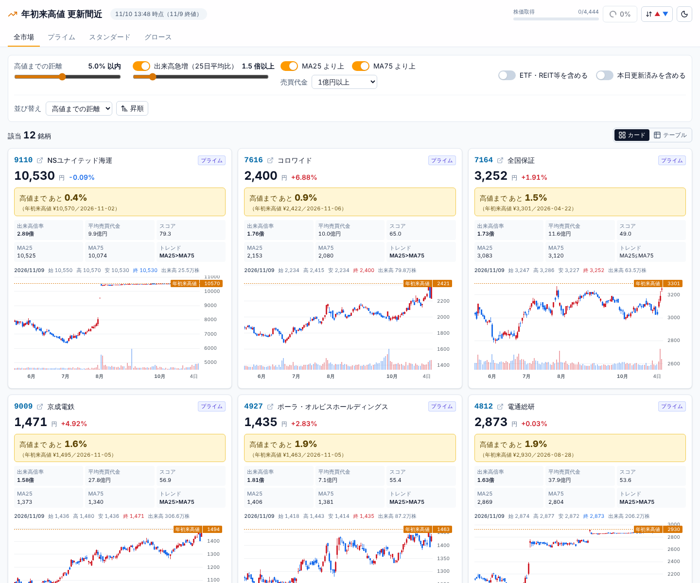

# kabu-breakout — 年初来高値「更新間近」銘柄スクリーナー

東証プライム／スタンダード／グロースの全銘柄から、**年初来高値まであと数%で、出来高を伴って更新しそうな銘柄**を毎営業日に自動抽出し、一覧とチャートで確認する Web アプリです（株探「本日、年初来高値を更新した銘柄」の一歩手前を探す用途）。

> **免責**：本ツールは情報提供のみを目的とし、投資助言ではありません。データの正確性は保証しません。



- 毎営業日 18:00（JST）に全銘柄の日足を取得して指標を計算（約5分）
- 条件（高値までの距離・出来高倍率・MA25/MA75・売買代金など）は画面で即時に変更でき、URL で共有可能
- TOB（公開買付け）の買付価格に張り付いた銘柄を除外（切り替え可能）。ETF・ETN、REIT、PRO Market 等、外国株は常に除外
- カード表示（120日ローソク足＋出来高＋年初来高値ライン）／テーブル表示（60日スパークライン）
- 手動更新ボタン（進捗表示・二重起動防止）、ダークモード、上昇／下落色の反転

---

## 目次
1. [クイックスタート（Docker）](#1-クイックスタートdocker)
2. [Docker を使わない場合](#2-docker-を使わない場合)
3. [初回のデータ取得と日々の更新](#3-初回のデータ取得と日々の更新)
4. [設定（.env）](#4-設定env)
5. [指標とスクリーニング条件の定義](#5-指標とスクリーニング条件の定義)
6. [API](#6-api)
7. [構成](#7-構成)
8. [テスト](#8-テスト)
9. [既知の制約・注意点](#9-既知の制約注意点)

---

## 1. クイックスタート（Docker）

必要なもの：Docker（Compose v2.24 以上）

```bash
git clone <このリポジトリ> kabu-breakout
```

```bash
cd kabu-breakout
```

```bash
docker compose up -d --build
```

- 画面：http://localhost:3000
- API：http://localhost:8000/api/health （Swagger UI は http://localhost:8000/docs）

初回はデータが空なので、画面右上の **「更新」** を押してください（初回は全期間を取得するため **約15分**、2回目以降は約5分）。進捗はボタン横のバーに表示されます。以降は平日 18:00 に自動で更新されます。

データ（SQLite）はホストの `./data/kabu.db` に保存され、コンテナを作り直しても残ります。

停止：

```bash
docker compose down
```

## 2. Docker を使わない場合

必要なもの：Python 3.11 以上、Node.js 20 以上（22 で動作確認）

### バックエンド（ポート 8000）

```bash
cd backend
```

```bash
python3 -m venv .venv
```

```bash
.venv/bin/pip install -r requirements.txt
```

```bash
.venv/bin/uvicorn app.main:app --port 8000
```

Windows では `.venv\Scripts\pip`・`.venv\Scripts\uvicorn` に読み替えてください。DB は既定で `<リポジトリ>/data/kabu.db` に作られます。

> スケジューラと二重起動防止のロックはプロセス内で管理しているため、**`--workers` は 1 のまま**にしてください。

### フロントエンド（ポート 3000）

別のターミナルで：

```bash
cd frontend
```

```bash
npm ci
```

```bash
npm run build
```

```bash
npm start
```

開発時は `npm run dev` でホットリロードが効きます。フロントエンドは `/api/*` をバックエンドに転送します。接続先は環境変数 `BACKEND_URL`（既定 `http://localhost:8000`）で、**起動時に**読まれます。

## 3. 初回のデータ取得と日々の更新

### 更新の流れ（1回の実行）
1. 銘柄一覧：JPX「東証上場銘柄一覧」（`data_j.xlsx`）を、前回から 7 日以上たっていれば取り込み直す
2. 株価：yfinance（`{code}.T`）で日足を取得
   - 初回：1〜3月は前年1月1日から、それ以外は当年1月1日（または 150 日前のうち早い方）から
   - 2回目以降：直近 10 営業日を取り直して上書き（修正値の反映）
   - 取り直した期間の終値が保存済みの値と 1% 以上ずれた銘柄は、**株式分割で過去分が調整し直された**とみなして全期間を取り直す
3. 判定日 T の足を持つ銘柄が 50% 未満なら「データ未更新」として結果を保存しない（定時実行では 30 分後に 1 回だけ再試行）
4. 全銘柄の指標を計算し、**絞り込む前の値**を `screen_results` に保存（画面の条件変更は API 側で絞り込むだけなので、再取得は不要）

### 判定日 T の決め方
- 営業日の **18:00（`BATCH_HOUR`:`BATCH_MINUTE`）以降** → 当日
- それより前・休場日 → 直前の営業日（取引時間中の途中の足を確定値として扱わないため）
- 休場日：土日、`jpholiday` の祝日、12/31〜1/3

### 自動更新
- バックエンドに組み込まれた APScheduler が **月〜金 18:00 JST** に実行し、休場日はスキップします。
- cron で動かしたい場合は CLI を使い、二重実行しないよう `.env` で `SCHEDULER_ENABLED=false` にしてください（同時に起動しても DB 上のロックで片方は止まります）。

```cron
5 18 * * 1-5  cd /path/to/kabu-breakout/backend && .venv/bin/python -m app.batch run >> ../data/batch.log 2>&1
```

### CLI（`backend/` で実行）

| コマンド | 内容 |
|---|---|
| `python -m app.batch run [--date YYYY-MM-DD] [--no-retry]` | 日次ジョブ。休場日は何もしない。データ未更新なら 30 分待って 1 回だけ再試行（`--no-retry` で無効）。成功で終了コード 0 |
| `python -m app.batch universe` | JPX 銘柄一覧だけを取り込む |
| `python -m app.batch fetch --sample 20` / `--codes 7203 6758` | 指定した銘柄の株価だけを取得する（動作確認用） |
| `python -m app.batch screen [--date YYYY-MM-DD]` | 保存済みの株価から指標を計算して表示する（保存しない） |
| `python -m app.batch rescreen [--date YYYY-MM-DD]` | 保存済みの株価から指標を計算し直して保存する（株価は取得しない。アップデート後や設定変更後に） |
| `python -m app.batch init-db` | テーブルを作成する |

Docker の場合は `docker compose exec backend python -m app.batch run` のように実行します。

## 4. 設定（.env）

リポジトリ直下に `.env` を置くと、Docker でもそうでなくても読み込まれます（`cp .env.example .env`）。`backend/.env` があればそちらが優先され、環境変数はさらに優先されます。**すべて省略可能**です。

| 変数 | 既定値 | 説明 |
|---|---|---|
| `DATABASE_URL` | `sqlite:///<リポジトリ>/data/kabu.db` | SQLite の場所。Docker では compose 側で `sqlite:////data/kabu.db` に固定 |
| `SCHEDULER_ENABLED` | `true` | 内蔵スケジューラを使うかどうか（cron で動かすなら `false`） |
| `BATCH_HOUR` / `BATCH_MINUTE` | `18` / `0` | 定時実行の時刻（JST）。判定日 T の切り替え時刻にも使う |
| `TIMEZONE` | `Asia/Tokyo` | スケジューラと判定日のタイムゾーン |
| `STALE_RETRY_MINUTES` | `30` | データ未更新のときに再試行するまでの分数 |
| `STALE_RATIO_THRESHOLD` | `0.5` | T の足を持つ銘柄がこの割合未満なら「データ未更新」 |
| `YTD_PREV_YEAR_UNTIL_MONTH` | `3` | この月までは年初来高値を前年1月から集計する（`0` で常に当年のみ） |
| `UNIVERSE_REFRESH_DAYS` | `7` | JPX 銘柄一覧を取り込み直す間隔（日） |
| `JPX_LIST_PAGE` | JPX の一覧ページ | `data_j.xls(x)` へのリンクを探すページ |
| `FETCH_CHUNK_SIZE` | `100` | `yf.download` 1 回あたりの銘柄数 |
| `FETCH_SLEEP_MIN` / `FETCH_SLEEP_MAX` | `1.0` / `2.0` | まとまりの間の待ち時間（秒・ランダム） |
| `FETCH_RETRIES` / `FETCH_BACKOFF_BASE` | `3` / `2.0` | 失敗時の再試行回数と指数バックオフの底（2, 4, 8 秒） |
| `REFETCH_BUSINESS_DAYS` | `10` | 2回目以降に取り直す直近の営業日数 |
| `SPLIT_DETECT_THRESHOLD` | `0.01` | 分割とみなして全期間を取り直す終値のずれ（1%） |
| `INITIAL_MIN_CALENDAR_DAYS` | `150` | 初回取得で最低限さかのぼる暦日（MA75 用） |
| `PINNED_DAYS` / `PINNED_RANGE_PCT` | `20` / `1.0` | 「値動きの止まった銘柄」の判定：直近 20 営業日の値幅（最高値−最安値）が終値の 1.0% 未満 |
| `VOL_AVG_DAYS` / `MA_SHORT` / `MA_LONG` / `TURNOVER_AVG_DAYS` / `MIN_HISTORY_DAYS` | `25` / `25` / `75` / `25` / `75` | 指標の日数（変えると画面の表記と合わなくなるので通常は変えない） |

フロントエンドの環境変数は `BACKEND_URL`（既定 `http://localhost:8000`）だけです。

`breakout_score` の重みは `backend/app/config.py` の定数（`SCORE_*`）にまとめてあります。

## 5. 指標とスクリーニング条件の定義

すべて日足（分割調整済み・配当調整なし）。T＝判定日。

| 項目 | 定義 |
|---|---|
| 年初来高値 `ytd_high` | **T の前営業日まで**の日中高値の最大値。集計開始は当年最初の営業日。ただし **1〜3月は前年1月から**（Yahoo!ファイナンス・株探と同じ慣行）。同じ値が複数あれば最初に付けた日を `ytd_high_date` とする |
| 高値までの距離 `dist_pct` | `(ytd_high − close_T) / ytd_high × 100` |
| 本日更新済み `updated_today` | `high_T > ytd_high`（並んだだけでは更新扱いにしない） |
| 出来高倍率 `vol_ratio` | `volume_T / T-1 までの 25 営業日平均`（T は平均に含めない） |
| MA25 / MA75 | T を含む直近 25 / 75 本の終値の単純平均 |
| 前日比 | `(close_T − close_T-1) / close_T-1 × 100` |
| 25日平均売買代金 | T を含む直近 25 日の `close × volume` の平均 |
| スコア | `(5 − dist_pct) × 10 + min(vol_ratio, 5) × 8 + (MA25 > MA75 ? 10 : 0)`（並び替え用） |
| 20日値幅 `range20_pct` | T を含む直近 20 営業日の `(最高値 − 最安値) / close_T × 100` |

既定の条件：

| 条件 | 既定（画面で変更できるのは市場タブ〜値動きの止まった銘柄まで） |
|---|---|
| 市場 | プライム・スタンダード・グロース |
| 高値までの距離 | `0 < dist_pct ≤ 5` |
| 本日更新済み | 除外 |
| 出来高急増 | `vol_ratio ≥ 1.5` |
| トレンド | `close > MA25` かつ `close > MA75` |
| 流動性 | 25日平均売買代金 1 億円以上 |
| 値動きの止まった銘柄 | 除外（`range20_pct < 1.0`。TOB の買付価格への張り付き、社債型種類株式など） |
| ETF・ETN／REIT・インフラファンド／PRO Market・出資証券 | 常に除外（画面には切り替えなし。API の `include_etf`・`include_reit`・`include_other` では含められる） |
| 外国株（JDR を含む） | 常に除外（JPX の区分が「〇〇（外国株式）」の銘柄。API の `include_foreign` では含められる） |

上場から 75 営業日未満、T の出来高が 0、T の足がない銘柄は常に除外します。

欠損日がある場合は、存在する営業日だけで計算します（MA などは「直近 N 本」）。

## 6. API

金額や率は丸めずに返します（表示の丸めはフロント側）。

| メソッド・パス | 内容 |
|---|---|
| `GET /api/screen` | 条件で絞り込んだ一覧。`market=all\|prime\|standard\|growth`、`max_dist`、`min_vol_ratio`、`vol_filter`、`above_ma25`、`above_ma75`、`min_turnover`、`include_etf`、`include_updated`、`sort=dist\|vol_ratio\|change\|score`、`order=asc\|desc`、`limit`（既定 200）、`run_date=YYYY-MM-DD`（過去の実行日の結果）、`include_reit`・`include_other`（PRO Market・出資証券）・`include_foreign`、`exclude_pinned`（既定 true）・`pinned_range_pct`、`with_spark=true`（60 日分の終値を付ける）→ `{run_date, updated_at, count, items}`。`count` は `limit` をかける前の件数 |
| `GET /api/stocks/{code}/chart?days=120` | 日足 OHLCV と `ytd_high` / `ytd_high_date`（`run_date` も指定可） |
| `POST /api/refresh` | 更新ジョブを非同期で開始（202）。実行中なら 409 と実行中の `run_id` |
| `GET /api/refresh/status` | `{running, phase, processed, total, errors, status, message, ...}` |
| `GET /api/health` | DB の状態、最後の実行、次回の定時実行の時刻 |

## 7. 構成

```
kabu-breakout/
├─ backend/                  FastAPI + pandas + SQLAlchemy + APScheduler
│  ├─ app/
│  │  ├─ main.py             API・結果のキャッシュ・スケジューラの起動
│  │  ├─ config.py           既定値と定数（.env で上書き）
│  │  ├─ db.py / models.py   SQLite（WAL）と 5 つのテーブル
│  │  ├─ providers/          PriceProvider（抽象）と yfinance 実装 ← J-Quants などに差し替え可能
│  │  ├─ universe.py         JPX 銘柄一覧の取り込み
│  │  ├─ prices.py           株価の保存・差分取得・分割の検出
│  │  ├─ screener.py         指標と条件（DB に依存しない純粋関数）
│  │  ├─ jobs.py             日次ジョブ本体（ロック・進捗）
│  │  ├─ scheduler.py        定時実行・データ未更新時の再試行
│  │  ├─ batch.py            CLI
│  │  └─ calendar_jp.py      営業日・判定日の判定
│  └─ tests/                 pytest（合成データ）
├─ frontend/                 Next.js 15 (App Router) + Tailwind CSS v4 + lightweight-charts
│  ├─ app/                   page / layout / api プロキシ（/api/* → BACKEND_URL）
│  ├─ components/            Header, FilterBar, StockCard, StockTable, CandleChart, Sparkline ほか
│  └─ lib/                   api / types / format / query（URL ⇄ 条件）/ prefs（色の反転）
├─ data/                     SQLite（git 管理外）
├─ docs/                     スクリーンショット
└─ docker-compose.yml
```

データ取得元を差し替える場合は、`providers/base.py` の `PriceProvider.fetch_daily()`（銘柄ごとの日足 DataFrame と失敗した銘柄を返す）を実装し、`jobs.JobRunner(provider_factory=...)` に渡します。

## 8. テスト

```bash
cd backend
```

```bash
.venv/bin/python -m pytest -q
```

48 件。合成データで以下を検証しています：①高値の 3% 下は抽出 ②本日更新済みは除外 ③出来高 1.4 倍は除外 ④MA75 の下は除外 ⑤1〜3月は前年の高値を使う ⑥平均出来高に T を含めない ⑦欠損日・データ不足でも落ちない。ほかに値動きの止まった銘柄・ETF/REIT/PRO Market/外国株の除外、旧版 DB への列の追加、営業日判定、差分取得と分割の検出、API（条件・ロック・進捗・データ未更新・再試行）、約 4,400 銘柄での応答速度。

フロントエンドの型チェック：

```bash
cd frontend
```

```bash
npm run lint
```

## 9. 既知の制約・注意点

**データ（yfinance）**
- yfinance は Yahoo Finance の非公式な利用手段です。**遅延・欠損・誤り・仕様変更があり得ます**。18:00 時点で当日分が揃っていない場合は「データ未更新」として結果を保存せず、30 分後に再試行します。
- 大量のアクセスでレート制限（HTTP 429）を受けることがあります。まとまりごとの待ち時間と再試行で緩和していますが、`FETCH_SLEEP_*` を大きくすると安定します。
- 一部の ETF・ETN と PRO Market 等の約 60 銘柄（全体の約 1.4%）は Yahoo にデータがなく、毎回「取得失敗」になります（`fetch_errors` に記録。プライム・スタンダード・グロースでは 0 件でした）。毎回の再試行でその分（最大 14 秒 × まとまりの数）時間がかかります。
- 株価は保存時に小数第 2 位で丸めています（yfinance の float32 由来の誤差を除くため）。
- 分割の検出は「取り直した直近 10 営業日の終値が 1% 以上ずれたら全期間を取り直す」方式です。10 営業日を超えて更新を止めていた場合も、最後に保存した日から取り直すので漏れません。

**計算・表示**
- Yahoo!ファイナンスの「年初来高値」欄は整数に丸めて表示されるため、呼値が 0.5 円・0.1 円の銘柄では 1 円未満の差が出ることがあります（35 銘柄で照合し、日付はすべて一致、値は 32 銘柄が完全に一致、3 銘柄が丸めの差）。
- TOB（株式公開買付け）の対象になった銘柄は、価格が買付価格付近に張り付いたまま「高値まで数%・出来高増」になりがちです。既定では「直近 20 営業日の値幅が 1% 未満」の銘柄を除外して防いでいますが、発表から日が浅い（値幅にまだ発表前の値動きが含まれる）場合や、買付価格の近辺で多少動いている場合はすり抜けることがあります。逆に、値動きがごく小さい銘柄は TOB でなくても除外されます。
- 対象は JPX「東証上場銘柄一覧」の銘柄だけです。名証・福証・札証にだけ上場している銘柄は、もともと含まれません。
- 銘柄名は JPX 一覧の表記を NFKC 正規化しています（全角英数字は半角になります）。
- テーブルの見出しクリックでの並び替えは、取得済みの行（最大 200 件）の中で行います。全件を対象にした並び替えはフィルタバーの「並び替え」を使ってください。

**運用**
- 認証はありません（ローカル利用が前提）。外部に公開しないでください。
- SQLite・プロセス内のスケジューラ・プロセス内のロックを使う前提のため、バックエンドは 1 プロセス・1 ワーカーで動かしてください（CLI との同時実行は DB 上のロックで防いでいます）。
- 過去の実行日の結果は API（`run_date`）で取得できますが、画面からは選べません。
- 旧版の DB は起動時に列が自動で追加されます。追加した条件（20日値幅・外国株）は、次回の更新か `python -m app.batch rescreen` の後に有効になります（それまでは除外されません）。
- 通知機能（メール・LINE など）はありません。
- 株探・Yahoo!ファイナンスはリンク先としてだけ使い、スクレイピングはしていません。

## データの出典
- 銘柄一覧：日本取引所グループ「東証上場銘柄一覧」
- 株価：Yahoo Finance（yfinance 経由）
